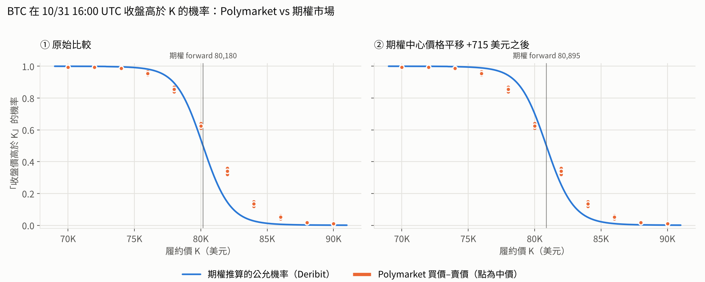
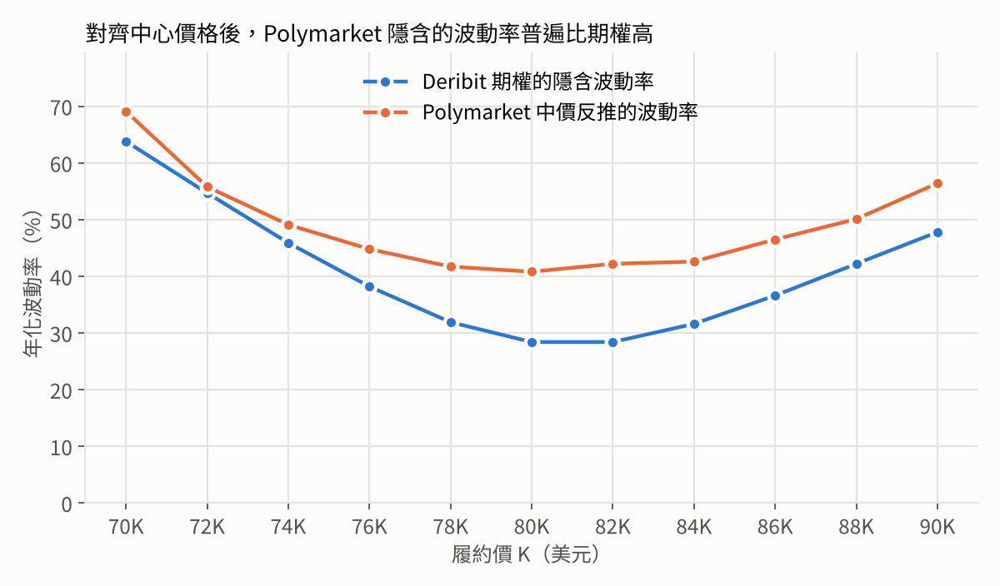

# 用 AI 做研究、寫程式：Polymarket vs 期權市場的錯價掃描器

> 課堂示範專案：從「現在加密貨幣市場還有哪些套利機會？」這個問題出發，
> 用 AI 做文獻與網路研究、挑出一個值得做的方向，再一路寫成可以跑、有測試的程式。

**這不是投資建議，也不是交易機器人。** 程式只讀公開資料、計算與比較，不會下單。

---

## 研究問題

Polymarket 上有很多「BTC 會不會漲到某個價位」的盤，例如：

- *Will the price of Bitcoin be above $80,000 on October 31?*（10/31 中午美東時間收盤高於 8 萬？）
- *Will Bitcoin dip to $77,500 in October?*（10 月內會不會跌到 7.75 萬？）

這些問題，**期權市場其實也有答案**。Deribit 的 BTC 期權價格隱含了市場對未來價格分布的看法，
可以換算成「收盤高於 K 的機率」、「期間內碰到 B 的機率」。

所以問題是：**同一件事，兩個市場給的機率一樣嗎？如果不一樣，差多少、差在哪？**

學術研究已經發現 Polymarket 的 BTC 價格盤平均比期權推算的機率高好幾個百分點，
而且偏差集中在尾部事件（詳見 [docs/research.md](docs/research.md)）。這個專案把這件事做成工具，讓你自己驗證。

## 快速開始

需要 Python 3.10 以上。

```bash
git clone https://github.com/Servalserval/professor-liao-class.git
cd professor-liao-class
pip install -r requirements.txt

# 1) 離線示範：用 repo 裡附的 2026-10-29 真實快照，不需要網路
python -m pmopt scan --snapshot data/snapshot_2026-10-29 --out results/demo --plot

# 2) 即時掃描一次（需要能連到 deribit.com 與 polymarket.com）
python -m pmopt scan --live

# 3) 每分鐘收集一次、連續 2 小時，存成 CSV；再彙整
python -m pmopt collect --minutes 120 --interval 60 --out data/live/scans.csv
python -m pmopt summarize data/live/scans.csv --out results/summary

# 跑測試
pip install pytest
python -m pytest
```

常用參數：`--asset ETH`（改看以太幣）、`--with-depth`（改用 CLOB 訂單簿的最佳價與掛單量）、
`--fee-coeff 0.07`（加上 taker 手續費模型）、`--slug <事件網址>`（指定要看的 Polymarket 事件）。

## 示範結果：2026-10-29 的快照

> ⚠️ 這份快照是在課程準備時用網頁擷取工具抓下來、再轉錄成 CSV 的，
> 兩邊時間沒有精確同步，也可能有轉錄錯誤。**它是教材，不是研究結論。**
> 詳見 [data/snapshot_2026-10-29/meta.json](data/snapshot_2026-10-29/meta.json)。



**第一眼（左圖）**：Polymarket 的報價整條都在期權曲線的右邊。例如「10/31 收盤高於 82,000」，
期權推算約 15%，Polymarket 卻報 32–36¢，看起來每股有 17¢ 的錯價。

**但先別急著興奮。** 所有市場往同一個方向偏，最常見的原因是兩份資料不是同一時間抓的，
或者其中一邊報價過時了。程式會自動找出「Polymarket 隱含的中心價格」：
這份快照裡，它比期權的 forward 高了約 **715 美元（+0.9%）**。

**對齊中心之後（右圖）**，剩下的差異比較有意義：Polymarket 的機率曲線**比較平**，
也就是兩邊的尾巴都比較厚。換成波動率來看更清楚：



在每一個履約價，Polymarket 隱含的波動率都比 Deribit 期權高；價平附近（80K–82K）大約是
41–42% 對 28%，差了 13 個百分點。這和學術研究「預測市場高估波動率、尤其是尾部」的發現方向一致。

### 課堂討論題

1. 左圖 17¢ 的「錯價」，有多少是真的、有多少只是時間差？你要怎麼設計資料收集，才能分辨？
2. 「10 月內會不會跌到 77,500」這個觸價盤，Polymarket 報 8–9¢，期權推算約 14%（對齊中心後）。
   而 Polymarket 自己的到期價格盤隱含「10/31 收盤低於 77,500」約 12%——觸價機率理論上大約是它的兩倍。
   **Polymarket 自己的兩組市場彼此也不一致**。這代表什麼？
3. 期權那邊是對的嗎？我們假設了 Deribit 的價格是「真相」，這個假設合理嗎？
4. 就算錯價是真的，要怎麼避險？Polymarket 的結算是 Binance BTC/USDT 某一分鐘的收盤價，
   Deribit 期權在 08:00 UTC 用自己的指數結算，兩者對不齊會帶來什麼風險？

## 方法摘要

| 步驟 | 做法 | 程式 |
|---|---|---|
| 解析題目 | 用正規表示式把題目拆成「題型 + 價位」，時間用 API 給的 `endDate` | `pmopt/parse.py` |
| 波動率曲面 | Deribit 每個到期日的 `mark_iv` → 清理填充值 → SVI 擬合 → 用總變異數 σ²T 在到期日之間內插 | `pmopt/surface.py` |
| 到期價格盤 | 數位買權 D(K) = −∂C/∂K，用中央差分把波動率微笑（skew）一起算進去 | `pmopt/pricing.py` |
| 觸價盤 | 對數常態、連續監看的觸價機率（反射原理），波動率取觸價價位的值 | `pmopt/pricing.py` |
| 比較 | edge = 公允值 − 賣價（買 Yes）或 買價 − 公允值（賣 Yes），可扣手續費 | `pmopt/scanner.py` |
| 中心對齊 | 平移期權曲面，找出最接近 Polymarket 中價的中心價格（最小平方） | `pmopt/scanner.py` |

完整的數學、假設和沒有處理的部分，請看 [docs/method.md](docs/method.md)。

## 專案結構

```
pmopt/
  pricing.py      Black-Scholes、數位期權（含 skew）、觸價機率、反推波動率
  surface.py      解析 Deribit 商品名稱、建立 SVI 波動率曲面
  parse.py        解析 Polymarket 題目
  deribit.py      Deribit 公開 API
  polymarket.py   Polymarket Gamma / CLOB 公開 API、事件網址的命名規則
  live.py         一次抓好兩邊的即時資料，並記錄時間差
  scanner.py      計算公允機率、edge、中心對齊
  report.py       畫圖與彙整
  __main__.py     命令列介面（scan / collect / summarize）
tests/            45 個測試：公式對 Monte Carlo、曲面的無套利性質、解析器、CLI 全流程
data/snapshot_2026-10-29/   離線示範用的真實快照
results/snapshot_2026-10-29/  示範輸出（CSV 與圖）
docs/
  research.md     研究過程與來源
  method.md       數學方法與限制
  ai-workflow.md  這個專案怎麼跟 AI 一起做出來的
```

## 限制

- **期權不一定是對的。** 這裡把 Deribit 當成基準，但它也只是另一個市場的報價。
- **沒有避險成本。** 真正要做套利，得用期權或永續合約避險，那部分的成本和風險都沒算。
- **結算規則對不齊。** Polymarket 看 Binance BTC/USDT 某一分鐘的收盤（或最高、最低價），
  Deribit 看自己的指數；時間點也不同。
- **觸價盤用的是近似。** 只用一個波動率，沒有完整考慮整條微笑曲線與時間結構。
- **使用資格。** 各平台都有地區限制，使用前請自行確認。

## 這個專案是怎麼做出來的

整個流程（研究 → 選題 → 寫程式 → 測試 → 示範）是和 AI 助手（Claude）一起完成的，
包括 AI 犯了哪些錯、是怎麼被測試抓到的。課堂上最值得看的是
[docs/ai-workflow.md](docs/ai-workflow.md)。
