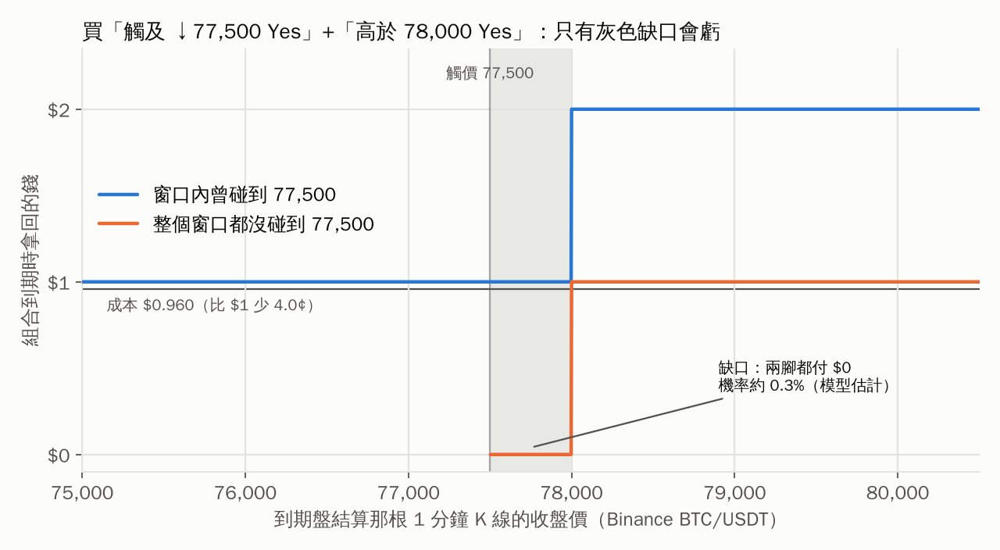

# 用 AI 做研究、寫程式：Polymarket vs 期權市場的錯價掃描器

> 課堂示範專案：從「現在加密貨幣市場還有哪些套利機會？」這個問題出發，
> 用 AI 做文獻與網路研究、挑出一個值得做的方向，再一路寫成可以跑、有測試的程式。

**這不是投資建議，也不是交易機器人。** 程式只讀公開資料、計算與比較，不會下單。

---

## 研究問題

Polymarket 上有很多「BTC 會不會漲到某個價位」的盤，例如：

- *Will the price of Bitcoin be above $80,000 on October 31?*（10/31 中午美東時間收盤高於 8 萬？）
- *Will Bitcoin dip to $77,500 in October?*（10 月內會不會跌到 7.75 萬？）

這些問題，**期權市場其實也有答案**。Deribit 的 BTC 期權價格隱含了市場對未來價格分布的看法，
可以換算成「收盤高於 K 的機率」、「期間內碰到 B 的機率」。

所以問題是：**同一件事，兩個市場給的機率一樣嗎？如果不一樣，差多少、差在哪？**

學術研究已經發現 Polymarket 的 BTC 價格盤平均比期權推算的機率高好幾個百分點，
而且偏差集中在尾部事件（詳見 [docs/research.md](docs/research.md)）。這個專案把這件事做成工具，讓你自己驗證。

## 快速開始

需要 Python 3.10 以上。

```bash
git clone https://github.com/Servalserval/professor-liao-class.git
cd professor-liao-class
pip install -r requirements.txt

# 1) 離線示範：用 repo 裡附的 2026-10-29 真實快照，不需要網路
python -m pmopt scan --snapshot data/snapshot_2026-10-29 --out results/demo --plot

# 2) 即時掃描一次（需要能連到 deribit.com 與 polymarket.com）
python -m pmopt scan --live

# 3) Polymarket 自己的兩組市場（觸價盤 vs 到期盤）彼此一致嗎？不需要期權也能檢查
python -m pmopt check --snapshot data/snapshot_2026-10-29 --out results/demo --plot

# 4) 每分鐘收集一次、連續 2 小時，存成 CSV；再彙整（也會記錄第 3 步的組合）
python -m pmopt collect --minutes 120 --interval 60 --out data/live/scans.csv
python -m pmopt summarize data/live/scans.csv --out results/summary

# 5) 歷史回測：過去已結算的每日盤，Polymarket 和期權模型誰比較準？（需要網路）
python -m pmopt backtest --start 2026-09-01 --end 2026-10-28 --horizons 24,6 --out results/backtest --verbose

# 跑測試
pip install pytest
python -m pytest
```

常用參數：`--asset ETH`（改看以太幣）、`--with-depth`（改用 CLOB 訂單簿的最佳價與掛單量）、
`--fee-coeff 0.07`（加上 taker 手續費模型）、`--slug <事件網址>`（指定要看的 Polymarket 事件）。

## 示範結果：2026-10-29 的快照

> ⚠️ 這份快照是在課程準備時用網頁擷取工具抓下來、再轉錄成 CSV 的，
> 兩邊時間沒有精確同步，也可能有轉錄錯誤。**它是教材，不是研究結論。**
> 詳見 [data/snapshot_2026-10-29/meta.json](data/snapshot_2026-10-29/meta.json)。


**第一眼（左圖）**：Polymarket 的報價整條都在期權曲線的右邊。例如「10/31 收盤高於 82,000」，
期權推算約 15%，Polymarket 卻報 32–36¢，看起來每股有 17¢ 的錯價。

**但先別急著興奮。** 所有市場往同一個方向偏，最常見的原因是兩份資料不是同一時間抓的，
或者其中一邊報價過時了。程式會自動找出「Polymarket 隱含的中心價格」：
這份快照裡，它比期權的 forward 高了約 **715 美元（+0.9%）**。

**對齊中心之後（右圖）**，剩下的差異比較有意義：Polymarket 的機率曲線**比較平**，
也就是兩邊的尾巴都比較厚。換成波動率來看更清楚：


在每一個履約價，Polymarket 隱含的波動率都比 Deribit 期權高；價平附近（80K–82K）大約是
41–42% 對 28%，差了 13 個百分點。這和學術研究「預測市場高估波動率、尤其是尾部」的發現方向一致。

### 課堂討論題

1. 左圖 17¢ 的「錯價」，有多少是真的、有多少只是時間差？你要怎麼設計資料收集，才能分辨？
2. 「10 月內會不會跌到 77,500」這個觸價盤，Polymarket 報 8–9¢，期權推算約 14%（對齊中心後）。
   而 Polymarket 自己的到期價格盤隱含「10/31 收盤低於 77,500」約 12%——觸價機率理論上大約是它的兩倍。
   **Polymarket 自己的兩組市場彼此也不一致**。這代表什麼？
3. 期權那邊是對的嗎？我們假設了 Deribit 的價格是「真相」，這個假設合理嗎？
4. 就算錯價是真的，要怎麼避險？Polymarket 的結算是 Binance BTC/USDT 某一分鐘的收盤價，
   Deribit 期權在 08:00 UTC 用自己的指數結算，兩者對不齊會帶來什麼風險？

## 第二輪：Polymarket 自己跟自己比

第一輪的比較有兩個弱點：要假設期權是對的，而且 Deribit 和 Polymarket 的結算來源、時間都對不齊。
第二輪改問一個比較乾淨的問題：**Polymarket 自己的兩組市場，彼此一致嗎？**

兩組市場都用 Binance BTC/USDT 的 1 分鐘 K 線結算，所以有不需要任何模型的關係。例如：

> 如果 10/31 中午那根 K 線**收盤** ≤ 77,500，那根 K 線的**最低價**一定也 ≤ 77,500，
> 所以「10 月內會跌到 77,500」一定成立。
> 因此「買觸及 ↓77,500 Yes + 買高於 77,500 Yes」不管發生什麼都至少拿回 $1。

`python -m pmopt check` 會列出所有這類組合（單調性、觸價 vs 到期），用**可成交的賣價**算買進成本。

**結果一：無模型的關係全部守住。** 106 組裡沒有任何一組成本低於 $1，好幾組剛好等於 $1.000。
看起來有人在專門維持這些邊界。

**結果二：差一點點就不守了。** 觸價盤是 77,500，到期盤只有 76,000 和 78,000。
「觸及 ↓77,500 Yes（0.090）+ 高於 78,000 Yes（0.870）」只要 **$0.960**，
只有在收盤落在 77,500–78,000 之間、而且整個窗口都沒碰到 77,500 時才會兩腳都歸零。
用反射原理算，這個機率約 **0.3%**；把 S 放在 79,500–81,500、σ 放在 20%–55% 之間，最高也只有約 1.2%。
加上手續費模型（c = 0.07）成本是 0.974，期望值仍為正。



**結果三：但這很可能又是時間差。** 程式會用期權的微笑形狀，分別反推兩組 Polymarket 市場「以為」BTC 在哪裡：

| 資料 | 隱含的中心價格 |
|---|---|
| Deribit 期權 | 80,166 |
| Polymarket 到期盤 | 80,880（+0.89%） |
| Polymarket 觸價盤 | 81,654（+1.86%） |

觸價盤的向上和向下兩邊**各自**都指向 81,600–81,900。三份資料像是在三個不同的 BTC 價位抓的。
不管用上表哪**一個**中心價格，這兩腳的公允值加總都在 1.056–1.108 之間（超過 1 是因為兩腳可能同時付錢），組合並不便宜。
那 4¢ 完全可以用「兩組市場在 BTC 相差約 770 美元的時候分別被抓下來」來解釋。

**第一輪學到「結果太好要懷疑」，第二輪學到：換一個更乾淨的方法，還是要再懷疑一次。**
要分辨真假，兩腳必須在**同一時刻**抓下來；`collect` 現在每一輪都會同時記錄這些組合和兩組市場各自的中心價格。

**結果四：形狀上的線索。** 用各自的中心價格對齊之後，觸價盤和 Deribit 的微笑形狀幾乎完全吻合
（5 個市場的平方誤差合計 0.00014），但到期盤的兩邊尾巴明顯比較厚。
如果這是真的，學術研究說的「Polymarket 高估尾部」可能主要發生在每日到期盤。
這要用很多天的資料驗證，所以新增了 `backtest`：拿過去已結算的每日盤，直接比較報價和實際結果。

### 第二輪討論題

5. 為什麼無模型的關係守得這麼緊（剛好 $1.000），差 500 美元的缺口卻可能留下 4¢？
   提示：誰在維持這些邊界？他們的程式需要模型嗎？
6. 「觸價盤的中心價格比到期盤高 0.96%」有幾種可能的解釋？你要收集什麼資料，才能把它們一一排除？
7. 回測時，同一天有十幾個履約價。為什麼不能把它們當成十幾個獨立樣本？（看 `history.clustered_mean_se`）

## 方法摘要

| 步驟 | 做法 | 程式 |
|---|---|---|
| 解析題目 | 用正規表示式把題目拆成「題型 + 價位」，時間用 API 給的 `endDate` | `pmopt/parse.py` |
| 波動率曲面 | Deribit 每個到期日的 `mark_iv` → 清理填充值 → SVI 擬合 → 用總變異數 σ²T 在到期日之間內插 | `pmopt/surface.py` |
| 到期價格盤 | 數位買權 D(K) = −∂C/∂K，用中央差分把波動率微笑（skew）一起算進去 | `pmopt/pricing.py` |
| 觸價盤 | 對數常態、連續監看的觸價機率（反射原理），波動率取觸價價位的值 | `pmopt/pricing.py` |
| 比較 | edge = 公允值 − 賣價（買 Yes）或 買價 − 公允值（賣 Yes），可扣手續費 | `pmopt/scanner.py` |
| 中心對齊 | 平移期權曲面，找出最接近 Polymarket 中價的中心價格（最小平方） | `pmopt/scanner.py` |
| 內部一致性 | 同一結算來源推出的支配關係；有缺口時用反射原理算「兩腳都歸零」的機率 | `pmopt/consistency.py` |
| 歷史校準 | 已結算的每日盤：報價 vs 實際結果，Brier score、分組校準、以「天」為群組的標準誤 | `pmopt/history.py` |

完整的數學、假設和沒有處理的部分，請看 [docs/method.md](docs/method.md)。

## 專案結構

```
pmopt/
  pricing.py      Black-Scholes、數位期權（含 skew）、觸價機率、反推波動率
  surface.py      解析 Deribit 商品名稱、建立 SVI 波動率曲面
  parse.py        解析 Polymarket 題目
  deribit.py      Deribit 公開 API
  polymarket.py   Polymarket Gamma / CLOB 公開 API、事件網址的命名規則
  live.py         一次抓好兩邊的即時資料，並記錄時間差
  scanner.py      計算公允機率、edge、中心對齊
  consistency.py  Polymarket 內部一致性：無模型的支配關係、近似套利的缺口機率
  history.py      歷史回測：已結算的每日盤、價格歷史、Binance K 線、DVOL、校準分析
  report.py       畫圖與彙整
  __main__.py     命令列介面（scan / check / collect / summarize / backtest）
tests/            71 個測試：公式對 Monte Carlo、曲面的無套利性質、解析器、模擬 API、合成資料、CLI 全流程
data/snapshot_2026-10-29/   離線示範用的真實快照
results/snapshot_2026-10-29/  示範輸出（CSV 與圖）
docs/
  research.md     研究過程與來源
  method.md       數學方法與限制
  ai-workflow.md  這個專案怎麼跟 AI 一起做出來的
```

## 限制

- **期權不一定是對的。** 這裡把 Deribit 當成基準，但它也只是另一個市場的報價。
- **沒有避險成本。** 真正要做套利，得用期權或永續合約避險，那部分的成本和風險都沒算。
- **結算規則對不齊。** Polymarket 看 Binance BTC/USDT 某一分鐘的收盤（或最高、最低價），
  Deribit 看自己的指數；時間點也不同。
- **觸價盤用的是近似。** 只用一個波動率，沒有完整考慮整條微笑曲線與時間結構。
- **使用資格。** 各平台都有地區限制，使用前請自行確認。
- **`backtest` 還沒有用真的 API 跑過。** 開發環境連不到 Polymarket、Binance、Deribit，
  資料格式是照官方文件寫的，並用模擬回應測試。第一次執行請加 `--verbose`，確認每一步都拿到資料。
- **手續費係數不確定。** 各來源對加密貨幣盤的 taker 費率說法不一（詳見 [docs/research.md](docs/research.md)），
  請以市場 API 的 `feeSchedule` 為準。

## 這個專案是怎麼做出來的

整個流程（研究 → 選題 → 寫程式 → 測試 → 示範）是和 AI 助手（Claude）一起完成的，
包括 AI 犯了哪些錯、是怎麼被測試抓到的。課堂上最值得看的是
[docs/ai-workflow.md](docs/ai-workflow.md)。
